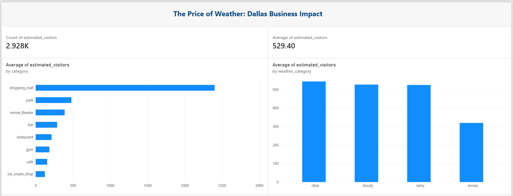
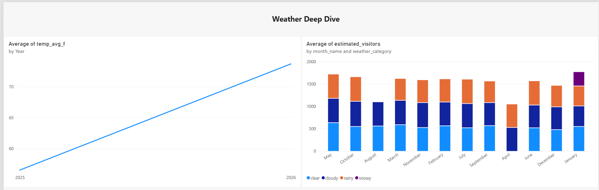
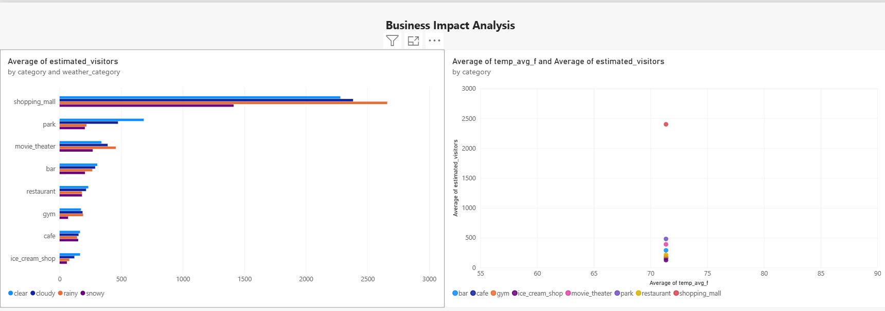
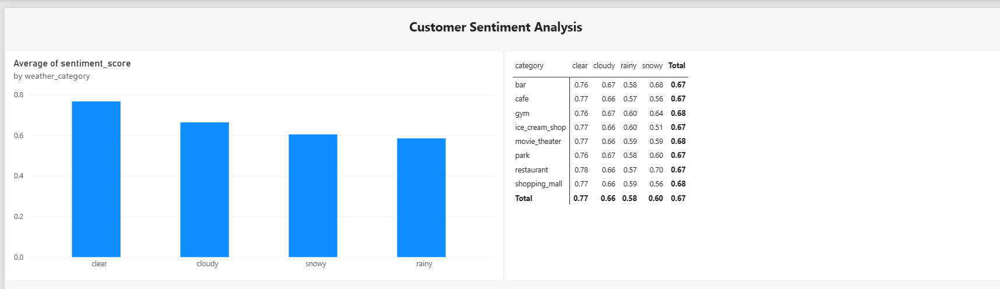

# ⛅ The Price of Weather: Dallas Business Impact Analysis

## How does weather affect local business foot traffic in Dallas, TX?

This project analyzes 12 months of weather data against 8 business categories to quantify weather's financial impact on local businesses. Using statistical testing and machine learning, it reveals which businesses thrive or suffer under different weather conditions.

---

## 🔑 Key Findings

- **Parks lose 84% of visitors** on rainy days vs clear days
- **Ice cream shops drop 52%** during rain
- **Movie theaters gain 35%** on rainy days (people go indoors!)
- **Shopping malls are most resilient** with only 15% drop
- Customer sentiment drops from **0.77 (clear) to 0.58 (rainy)**
- All findings are **statistically significant** (p < 0.05)

---

## 🛠 Tech Stack

| Layer | Tools |
|-------|-------|
| Data Collection | Python, OpenWeatherMap API, Google Places API, Yelp API |
| Cloud Storage | Google BigQuery |
| Pipeline | Prefect (automated ETL) |
| Analysis | pandas, scipy, scikit-learn |
| Visualization | Power BI (4-page dashboard), Streamlit (interactive web app) |
| Charts | matplotlib, seaborn, plotly |

---

## 📊 Power BI Dashboard

### Page 1: Overview


### Page 2: Weather Deep Dive


### Page 3: Business Impact


### Page 4: Sentiment Analysis


---

## 🌐 Streamlit Web App

Interactive web application with filters, heatmaps, and a weather prediction simulator.

[🎬 Watch Streamlit Demo](screenshots/streamlit_demo.webm)

---

## 📁 Project Structure

```
price-of-weather/
├── scripts/
│   ├── fetch_weather.py              # Current weather from OpenWeatherMap
│   ├── fetch_historical_weather.py   # 12-month weather from Visual Crossing
│   ├── fetch_businesses.py           # Google Places API (8 categories)
│   ├── fetch_yelp_reviews.py         # Yelp Fusion API business data
│   ├── upload_to_bigquery.py         # Upload raw data to BigQuery
│   ├── pipeline.py                   # Prefect automated ETL pipeline
│   ├── clean_and_merge.py            # Data cleaning & feature engineering
│   ├── simulate_traffic.py           # Realistic foot traffic simulation
│   ├── analyze_v2.py                 # Statistical analysis & visualizations
│   ├── predict_traffic.py            # Random Forest prediction model
│   ├── export_for_powerbi.py         # Export data for Power BI
│   └── app.py                        # Streamlit interactive web app
├── config/                           # API keys & credentials (gitignored)
├── data/
│   ├── raw/                          # Raw API responses
│   └── processed/                    # Cleaned & analyzed data
├── screenshots/                      # Dashboard & app screenshots
├── requirements.txt
└── README.md
```

---

## 🚀 How to Run

1. Clone this repo
```bash
git clone https://github.com/shannu-61/price-of-weather.git
cd price-of-weather
```

2. Create virtual environment
```bash
python -m venv venv
venv\Scripts\activate
```

3. Install dependencies
```bash
pip install -r requirements.txt
```

4. Add your API keys in `config/secrets.py`
```python
OPENWEATHER_API_KEY = "your_key"
VISUAL_CROSSING_API_KEY = "your_key"
GOOGLE_PLACES_API_KEY = "your_key"
YELP_API_KEY = "your_key"
```

5. Add BigQuery service account key as `config/bigquery_key.json`

6. Run the full pipeline
```bash
python scripts/pipeline.py
```

7. Run the analysis
```bash
python scripts/analyze_v2.py
python scripts/predict_traffic.py
```

8. Launch the Streamlit app
```bash
streamlit run scripts/app.py
```

---

## 📈 Statistical Methods

| Method | Purpose | Result |
|--------|---------|--------|
| Independent T-test | Compare rainy vs clear day visitors | 5/8 categories significant (p < 0.05) |
| Pearson Correlation | Temperature vs foot traffic | r = -0.365 for parks (strong negative) |
| Random Forest | Predict visitors from weather | Trained per-category models |
| Sentiment Scoring | Customer mood vs weather | Clear = 0.77, Rainy = 0.58 |

---

## 📦 Data Sources

| Source | Data | Records |
|--------|------|---------|
| OpenWeatherMap API | Current Dallas weather | Daily |
| Visual Crossing API | 12-month historical weather | 366 days |
| Google Places API | Business locations & ratings | 80 businesses |
| Yelp Fusion API | Business reviews & ratings | 80 businesses |

**BigQuery Tables:** daily_weather, google_businesses, yelp_businesses, weather_clean, business_clean, analysis_table, daily_traffic

---

## 💡 Business Insights

### Winners on Rainy Days
- Movie Theaters (+35%)
- Shopping Malls (+17%)
- Gyms (+10%)

### Losers on Rainy Days
- Parks (-68%)
- Ice Cream Shops (-52%)
- Cafes (-25%)

### Recommendation
Local businesses should use weather forecasts to adjust staffing, inventory, and marketing. Indoor businesses can capitalize on bad weather with targeted promotions.

---

## 👤 Author

**Shanmuga Kothapalli**
*Mid-Level Data Analyst | Dallas, TX*

---

## 📄 License

This project is for portfolio and educational purposes.